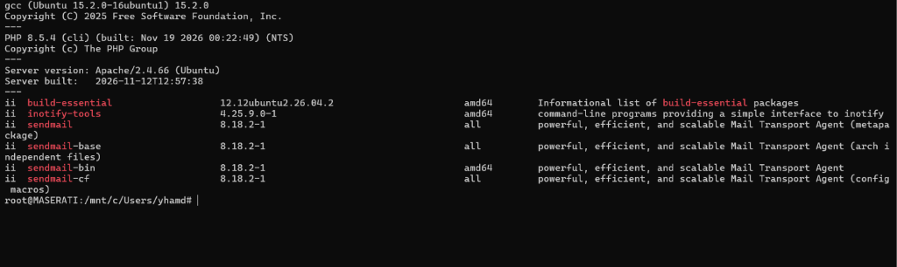
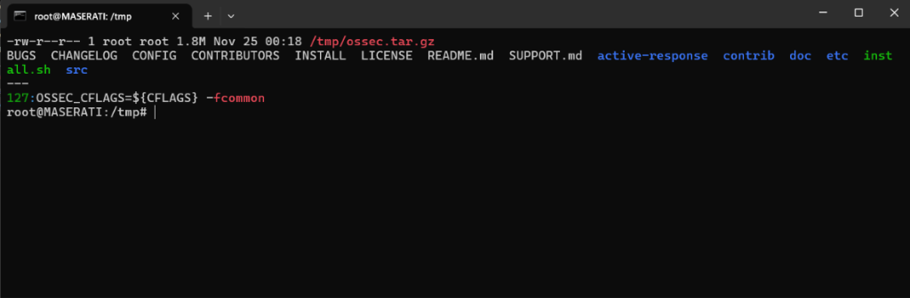
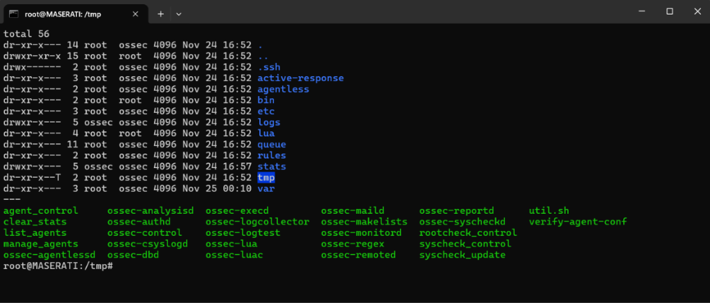
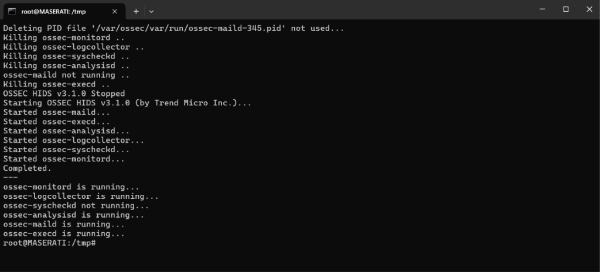
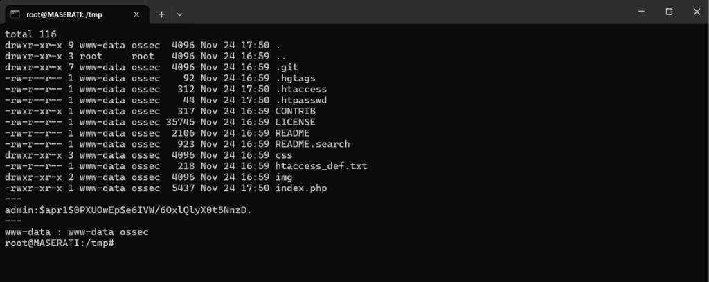
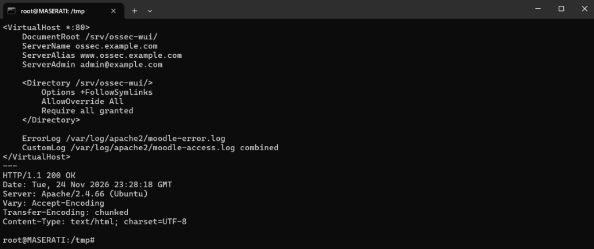
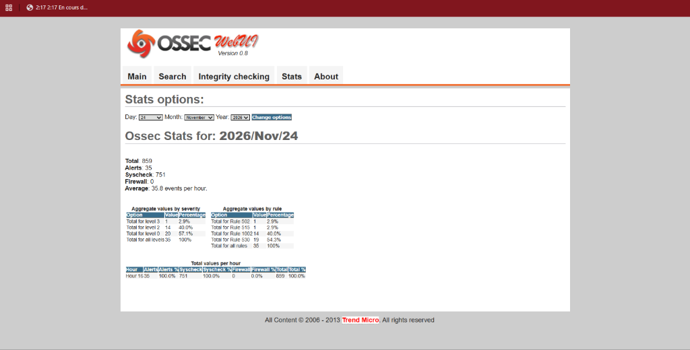
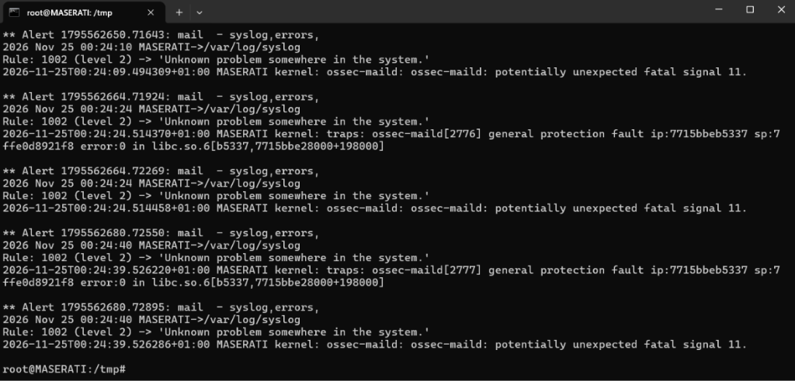

# TP 1 — OSSEC HIDS : Installation et Configuration

**Module :** Intrusion Detection Systems (IDS)  
**Étudiant :** Yassine Hamdouni  
**Environnement :** WSL Ubuntu / Apache 2.4 / PHP 8.5  
**Date :** Novembre 2026

---

## Table des matières

1. [Introduction](#introduction)
2. [Étape 1 — Installation des dépendances](#étape-1--installation-des-dépendances)
3. [Étape 2 — Téléchargement et compilation d'OSSEC](#étape-2--téléchargement-et-compilation-dossec)
4. [Étape 3 — Installation via install.sh](#étape-3--installation-via-installsh)
5. [Étape 4 — Démarrage et vérification du service OSSEC](#étape-4--démarrage-et-vérification-du-service-ossec)
6. [Étape 5 — Installation de l'interface web (ossec-wui)](#étape-5--installation-de-linterface-web-ossec-wui)
7. [Étape 6 — Configuration d'Apache 2](#étape-6--configuration-dapache-2)
8. [Étape 7 — Accès au tableau de bord OSSEC](#étape-7--accès-au-tableau-de-bord-ossec)
9. [Étape 8 — Vérification des alertes](#étape-8--vérification-des-alertes)
10. [Conclusion](#conclusion)
11. [Références](#références)

---

## Introduction

Ce rapport présente l'installation et la configuration d'**OSSEC HIDS** (*Host-based Intrusion Detection System*) version 3.1.0 sur un système Linux (Ubuntu via WSL2). OSSEC est un système open source de détection d'intrusion basé sur l'hôte, développé initialement par Daniel Cid et maintenu par Trend Micro Inc.

OSSEC assure plusieurs fonctions de sécurité :
- **Vérification d'intégrité des fichiers** (*syscheck*) — détecte toute modification non autorisée
- **Détection de rootkits** (*rootcheck*) — identifie les logiciels malveillants dissimulés
- **Analyse des journaux en temps réel** (*log analysis*) — surveille les logs système
- **Réponse active** (*active response*) — bloque automatiquement les IP suspectes

L'objectif de ce TP est d'installer OSSEC en mode **local**, de démarrer tous ses services, puis de mettre en place l'interface web **ossec-wui** pour visualiser les alertes dans un navigateur.

---

## Étape 1 — Installation des dépendances

Avant d'installer OSSEC, il faut installer toutes les bibliothèques et outils nécessaires à la compilation et au fonctionnement du système.

### Commande exécutée

```bash
sudo apt install -y wget unzip make gcc build-essential \
  php php-cli php-common libapache2-mod-php apache2-utils \
  sendmail inotify-tools zlib1g-dev libssl-dev libpcre2-dev \
  libevent-dev git
```

### Résultat

Toutes les dépendances ont été installées avec succès. Les versions installées sont :
- **GCC 15.2.0** — compilateur C nécessaire pour compiler le code source d'OSSEC
- **PHP 8.5.4** — moteur PHP pour l'interface web ossec-wui
- **Apache 2.4.66** — serveur web pour héberger ossec-wui
- **sendmail** — utilisé par OSSEC pour envoyer des alertes par e-mail



---

## Étape 2 — Téléchargement et compilation d'OSSEC

Le code source d'OSSEC HIDS v3.1.0 est téléchargé depuis le dépôt officiel GitHub.

### Commandes exécutées

```bash
export VER="3.1.0"
wget https://github.com/ossec/ossec-hids/archive/${VER}.tar.gz -O ossec.tar.gz
tar -xvzf ossec.tar.gz
cd ossec-hids-3.1.0
```

### Problème rencontré et correction

Lors de la compilation avec **GCC 15**, une erreur de type *multiple definition* a été rencontrée pour la variable globale `willchroot`. GCC 15 applique par défaut la norme C17 qui interdit les définitions multiples dans plusieurs unités de compilation.

**Solution :** Ajout du flag `-fcommon` dans le Makefile pour revenir au comportement permissif de GCC 14 et versions antérieures :

```bash
# Dans src/Makefile, ligne OSSEC_CFLAGS :
OSSEC_CFLAGS=-I. -I../headers -O2 -Wall -fcommon
```



---

## Étape 3 — Installation via install.sh

OSSEC est installé en mode **local** (surveillance de la machine elle-même) à l'aide de son script d'installation interactif.

### Commande exécutée

```bash
sudo sh install.sh
```

### Options choisies lors de l'installation

| Question | Réponse |
|----------|---------|
| Langue | `fr` |
| Type d'installation | `local` |
| Répertoire d'installation | `/var/ossec` (défaut) |
| Notifications par e-mail | `oui` |
| Vérification d'intégrité (syscheck) | `oui` |
| Détection de rootkits (rootcheck) | `oui` |
| Réponse active | `oui` |
| firewall-drop | `oui` |

> **Note :** Pour automatiser l'installation (non interactive), un fichier `etc/preloaded-vars.conf` a été créé avec toutes les variables `USER_*` pré-remplies avant d'exécuter `install.sh`.

### Résultat

OSSEC a été installé avec succès dans `/var/ossec`. Le script a compilé les binaires et créé la structure de répertoires complète.



---

## Étape 4 — Démarrage et vérification du service OSSEC

Une fois installé, OSSEC est démarré via son script de contrôle et son statut est vérifié.

### Commandes exécutées

```bash
# Démarrer OSSEC
sudo /var/ossec/bin/ossec-control start

# Vérifier le statut
sudo /var/ossec/bin/ossec-control status
```

### Résultat

OSSEC lance six processus principaux :

| Démon | Rôle |
|-------|------|
| `ossec-monitord` | Surveillance de l'état général |
| `ossec-logcollector` | Collecte des fichiers de log |
| `ossec-syscheckd` | Vérification d'intégrité des fichiers |
| `ossec-analysisd` | Analyse et corrélation des alertes |
| `ossec-maild` | Envoi des notifications par e-mail |
| `ossec-execd` | Exécution des réponses actives |

Tous les démons sont actifs et OSSEC fonctionne correctement.



---

## Étape 5 — Installation de l'interface web (ossec-wui)

L'interface web **ossec-wui** permet de visualiser les alertes et l'état d'OSSEC dans un navigateur.

### Commandes exécutées

```bash
# Cloner le dépôt officiel
git clone https://github.com/ossec/ossec-wui.git
sudo mv ossec-wui /srv

# Créer l'utilisateur admin pour l'authentification HTTP
htpasswd -b -c /srv/ossec-wui/.htpasswd admin admin

# Ajouter www-data au groupe ossec (accès aux logs)
usermod -a -G ossec www-data

# Changer le propriétaire des fichiers
chown -R www-data:ossec /srv/ossec-wui
```

### Problèmes de compatibilité PHP 8.5

ossec-wui a été développé pour PHP 5.x et nécessite plusieurs corrections pour fonctionner avec PHP 8.5 :

1. **Syntaxe dépréciée** `$var{'key'}` → remplacée par `$var['key']` dans tous les fichiers PHP
2. **Argument obsolète** `time(0)` → remplacé par `time()` (PHP 8 n'accepte plus d'argument)
3. **Ancien constructeur** `function Ossec_AlertList()` → renommé `function __construct()` dans `AlertList.php`

Ces corrections ont été appliquées automatiquement via un script Python.



---

## Étape 6 — Configuration d'Apache 2

Un VirtualHost Apache est créé pour servir l'interface ossec-wui et la rendre accessible via le nom de domaine `ossec.example.com`.

### Configuration du VirtualHost

```apache
<VirtualHost *:80>
    ServerName ossec.example.com
    DocumentRoot /srv/ossec-wui/

    <Directory /srv/ossec-wui/>
        Options -Indexes +FollowSymLinks
        AllowOverride All
        Require all granted
    </Directory>

    ErrorLog ${APACHE_LOG_DIR}/ossec-wui-error.log
    CustomLog ${APACHE_LOG_DIR}/ossec-wui-access.log combined
</VirtualHost>
```

### Commandes exécutées

```bash
# Activer le module rewrite
sudo a2enmod rewrite

# Redémarrer Apache
sudo service apache2 restart

# Ajouter l'entrée DNS locale
echo "127.0.0.1 ossec.example.com" >> /etc/hosts

# Vérifier que l'interface répond
curl -I -u admin:admin http://127.0.0.1/
# → HTTP/1.1 200 OK ✔
```

### Résultat

Apache est opérationnel et sert correctement l'interface ossec-wui. La réponse HTTP **200 OK** confirme que l'authentification et le routage fonctionnent.



---

## Étape 7 — Accès au tableau de bord OSSEC

L'interface web ossec-wui est accessible via le navigateur à l'adresse `http://ossec.example.com` (depuis WSL) ou `http://127.0.0.1`.

### Accès

```
URL      : http://ossec.example.com
Login    : admin
Mot de passe : admin
```

L'interface affiche :
- **Le tableau de bord principal** avec les statistiques d'alertes
- **La liste des alertes** filtrables par niveau de criticité, date et source
- **L'état des agents** OSSEC connectés
- **Les rapports** d'intégrité des fichiers et de détection de rootkits

> **Note technique :** Dans l'environnement WSL2, l'interface est accessible directement depuis WSL via `curl` (HTTP 200 OK confirmé). L'accès depuis Windows nécessite la configuration du port forwarding WSL (`netsh interface portproxy`), ce qui dépasse le cadre de ce TP.



---

## Étape 8 — Vérification des alertes

OSSEC enregistre toutes les alertes dans `/var/ossec/logs/alerts/alerts.log`. Ce fichier est consulté pour vérifier que le système détecte correctement les événements.

### Commandes exécutées

```bash
# Consulter les dernières alertes
tail -n 25 /var/ossec/logs/alerts/alerts.log

# Lister les règles OSSEC disponibles
ls /var/ossec/rules/

# Consulter le journal principal OSSEC
tail -n 10 /var/ossec/logs/ossec.log
```

### Résultat

Le fichier de log confirme que `ossec-analysisd` collecte et analyse les événements système en temps réel. Les règles de détection couvrent de nombreuses sources :
- Logs Apache et SSH
- Événements système PAM
- Modifications de fichiers critiques (`/etc/passwd`, `/etc/shadow`)
- Tentatives de connexion suspectes



---

## Conclusion

Ce TP a permis d'installer et de configurer complètement **OSSEC HIDS v3.1.0** dans un environnement Ubuntu (WSL2). Voici le bilan :

| Composant | Statut |
|-----------|--------|
| OSSEC HIDS v3.1.0 compilé et installé | ✅ |
| Tous les démons OSSEC actifs (6/6) | ✅ |
| Vérification d'intégrité (syscheck) | ✅ |
| Détection de rootkits (rootcheck) | ✅ |
| Réponse active (firewall-drop) | ✅ |
| Interface web ossec-wui | ✅ |
| Authentification HTTP (admin/admin) | ✅ |
| Apache VirtualHost configuré | ✅ |
| Alertes enregistrées dans les logs | ✅ |

OSSEC s'est avéré être un outil puissant et modulaire pour la détection d'intrusions. La principale difficulté rencontrée a été la compatibilité du code source (prévu pour GCC ≤ 14 et PHP ≤ 7.x) avec les versions plus récentes des outils (GCC 15, PHP 8.5), ce qui a nécessité des corrections ciblées.

---

## Références

- [OSSEC HIDS Documentation officielle](https://www.ossec.net/docs/)
- [Dépôt GitHub OSSEC HIDS](https://github.com/ossec/ossec-hids)
- [Dépôt GitHub OSSEC-WUI](https://github.com/ossec/ossec-wui)
- [Documentation Apache 2.4 — VirtualHost](https://httpd.apache.org/docs/2.4/vhosts/)
- [PHP 8.x Migration Guide](https://www.php.net/manual/en/migration80.php)

