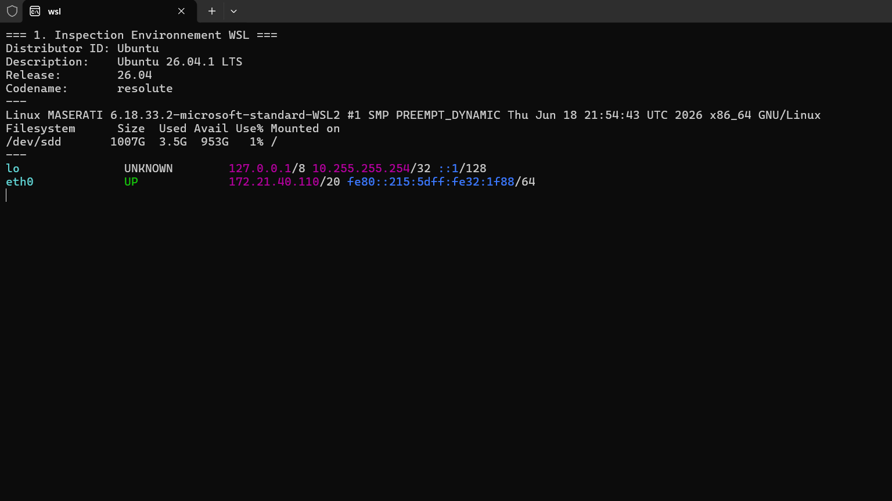
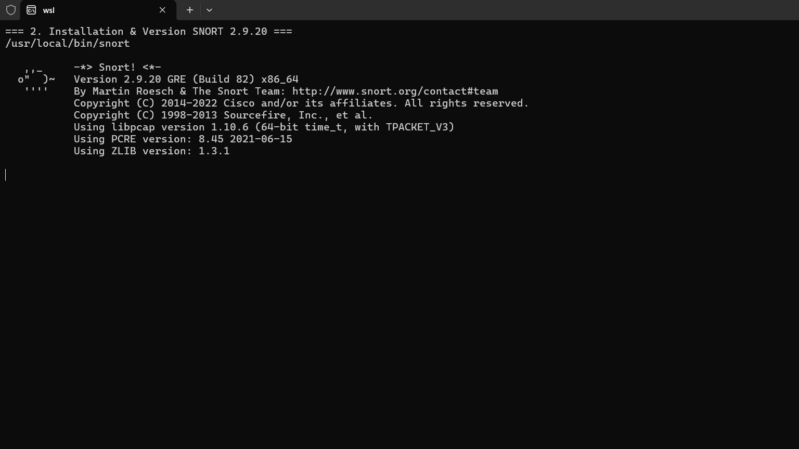
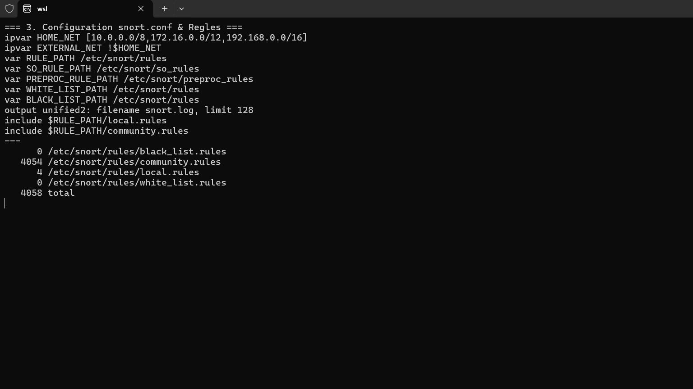
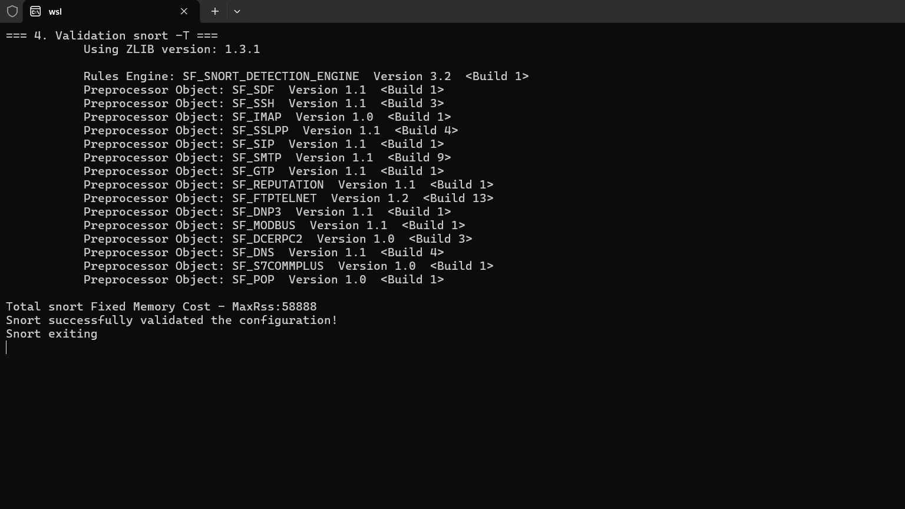
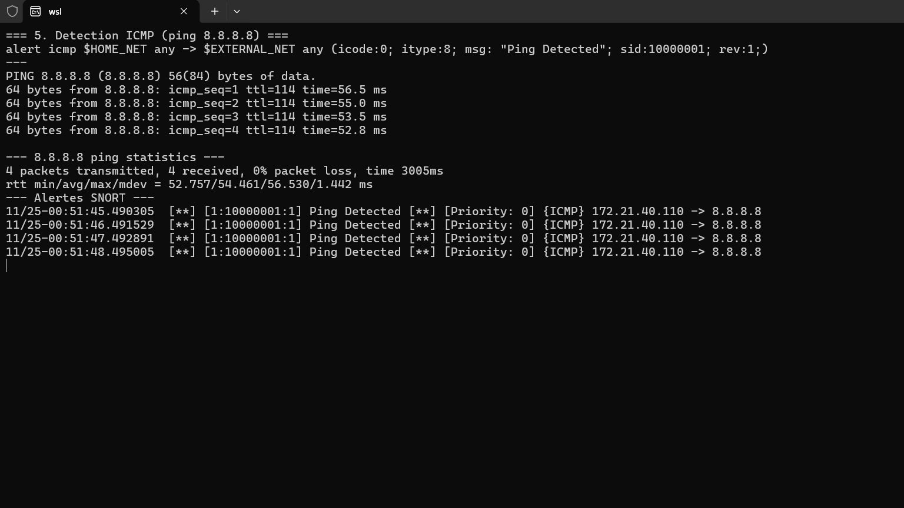
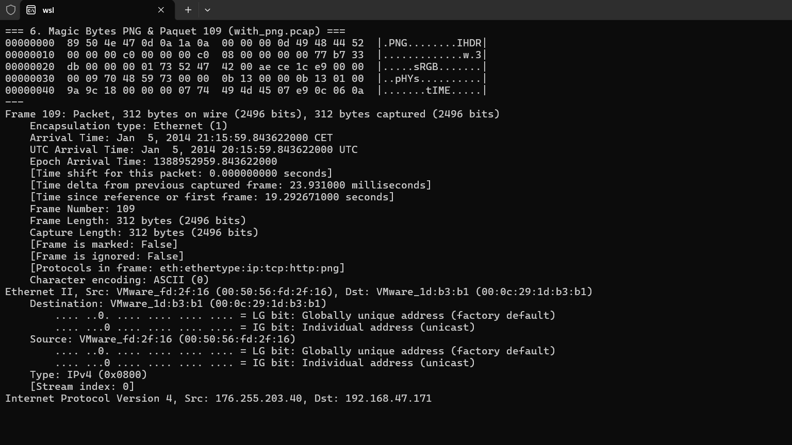
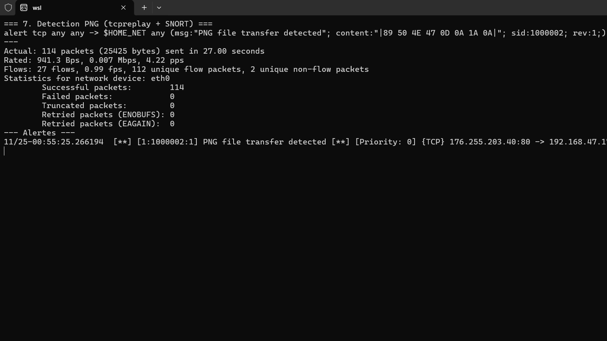
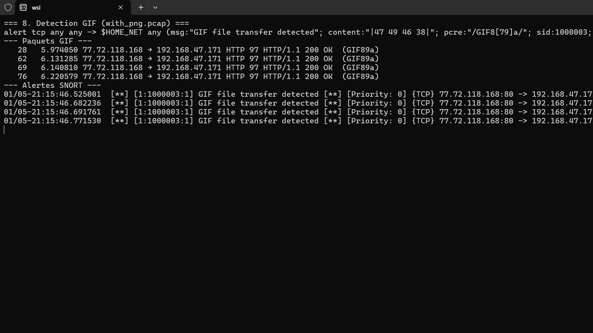
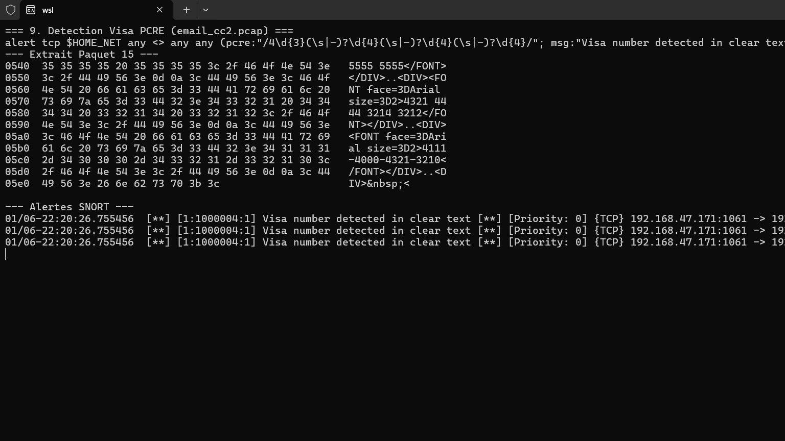

# TP 2 — Network Intrusion Detection using SNORT

**Module :** Intrusion Detection  
**Classe :** ING-5-J-SSIR  
**Année universitaire :** 2026–2027  
**Environnement :** WSL2 Ubuntu 26.04.1 LTS (x86_64) — SNORT 2.9.20 GRE  

---

## Table des matières

1. [Introduction](#1-introduction)
2. [Objectifs du TP](#2-objectifs-du-tp)
3. [Environnement de travail et prérequis](#3-environnement-de-travail-et-prérequis)
4. [Installation de SNORT](#4-installation-de-snort)
5. [Configuration de SNORT comme NIDS](#5-configuration-de-snort-comme-nids)
6. [Configuration des règles](#6-configuration-des-règles)
7. [Validation de la configuration](#7-validation-de-la-configuration)
8. [Détection ICMP](#8-détection-icmp)
9. [Détection des fichiers PNG](#9-détection-des-fichiers-png)
10. [Détection des fichiers GIF](#10-détection-des-fichiers-gif)
11. [Détection des numéros Visa en clair](#11-détection-des-numéros-visa-en-clair)
12. [Réponses aux questions théoriques](#12-réponses-aux-questions-théoriques)
13. [Difficultés rencontrées et solutions](#13-difficultés-rencontrées-et-solutions)
14. [Conclusion générale](#14-conclusion-générale)

---

## 1. Introduction

Un système de détection d'intrusion réseau (**NIDS** — *Network Intrusion Detection System*) analyse en temps réel ou hors ligne le trafic circulant sur une interface réseau afin d'identifier des activités suspectes, des attaques, des malwares ou des violations de politique de sécurité. **SNORT** est l'un des moteurs NIDS open source les plus répandus : il combine l'analyse protocolaire, la détection par signatures et le filtrage par expressions régulières (**PCRE**).

Ce compte rendu présente la réalisation complète du TP *« Network Intrusion Detection using SNORT »* dans un environnement local **WSL2 Ubuntu 26.04 LTS**, tout en conservant l'ensemble des objectifs pédagogiques du sujet initialement prévu pour CentOS 8 et SNORT 2.9.

---

## 2. Objectifs du TP

- Installer et compiler **SNORT 2.9** dans l'environnement WSL Ubuntu en respectant les contraintes de compatibilité.
- Configurer SNORT en mode **NIDS** (variables réseau, chemins des règles, sortie `unified2`, jeu de règles).
- Valider la syntaxe et le chargement des préprocesseurs avec `snort -T`.
- Écrire et tester des règles personnalisées dans `local.rules` pour détecter :
  - le trafic **ICMP Echo Request** ;
  - le transfert de fichiers **PNG** ;
  - le transfert de fichiers **GIF** ;
  - l'envoi de numéros de carte **Visa** en clair via **PCRE**.
- Analyser des captures réseau PCAP (`with_png.pcap` et `email_cc2.pcap`) avec `tshark`, `tcpreplay` et `snort -r`.

---

## 3. Environnement de travail et prérequis

- **Objectif :** Inspecter l'environnement WSL2 avant toute modification du système.
- **Explication technique :** L'hôte Windows exécute WSL2 (`2.7.12.0`) avec Ubuntu `26.04.1 LTS` (*Resolute*). L'interface réseau active `eth0` possède l'adresse `172.21.40.110/20` et `953 Go` d'espace disque sont disponibles. Avant l'intervention, SNORT n'était ni installé ni disponible dans les dépôts APT d'Ubuntu 26.04.

```bash
lsb_release -a
uname -a
df -h /
ip -br addr
```

- **Résultat réellement obtenu :** Ubuntu 26.04.1 LTS (noyau `6.18.33.2-microsoft-standard-WSL2`), interfaces `lo` (`127.0.0.1/8`) et `eth0` (`172.21.40.110/20`).



- **Interprétation :** L'adresse IP de `eth0` appartenant au bloc privé `172.16.0.0/12`, la variable `$HOME_NET` devra inclure ce réseau en plus de `10.0.0.0/8` et `192.168.0.0/16`.

---

## 4. Installation de SNORT

- **Objectif :** Installer **SNORT 2.9.20** de manière fiable sous Ubuntu 26.04 sans recourir aux paquets RPM CentOS.
- **Explication technique :** Sur Ubuntu 26.04, `snort` 2.9 et `libpcre3-dev` ne sont plus fournis par APT. Nous avons installé les dépendances disponibles (`build-essential`, `flex`, `bison`, `libpcap-dev`, `libdumbnet-dev`, `libdaq-dev` 2.0.7, `zlib1g-dev`, `libnghttp2-dev`, `libluajit-5.1-dev`, `libssl-dev`, `liblzma-dev`, `libtirpc-dev`, `tcpdump`, `tshark`, `tcpreplay`), compilé **PCRE 8.45** depuis les sources dans `/usr/local`, puis compilé **SNORT 2.9.20** avec les options adaptées à GCC 15 (`-std=gnu17 -fcommon`) et aux en-têtes SunRPC de `libtirpc` (`-I/usr/include/tirpc -ltirpc`). Aucune règle du pare-feu Windows ni sécurité WSL n'a été désactivée.

```bash
apt-get install -y build-essential flex bison libpcap-dev libdumbnet-dev libdaq-dev \
  zlib1g-dev libnghttp2-dev libluajit-5.1-dev libssl-dev liblzma-dev libtirpc-dev \
  tcpdump tshark tcpreplay

# Compilation PCRE 8.45 + SNORT 2.9.20
./configure --enable-sourcefire --disable-open-appid
make -j$(nproc) && make install && ldconfig
snort -V
```

- **Résultat réellement obtenu :** SNORT `Version 2.9.20 GRE (Build 82) x86_64` installé avec `libpcap 1.10.6`, `PCRE 8.45` et `ZLIB 1.3.1`.



- **Interprétation :** La compilation depuis les sources garantit une compatibilité complète avec les règles et options du TP 2.9.

---

## 5. Configuration de SNORT comme NIDS

- **Objectif :** Mettre en place l'arborescence `/etc/snort`, les permissions et le jeu de règles.
- **Explication technique :** Par sécurité, l'Oinkcode d'exemple du sujet n'a pas été réutilisé. Nous avons utilisé le jeu officiel gratuit **Community Rules** (`community-rules.tar.gz`), créé l'utilisateur système `snort`, sauvegardé le fichier `snort.conf` original dans [`configs/configuration_backups/snort.conf.orig`](../configs/configuration_backups/snort.conf.orig), puis créé `local.rules`, `white_list.rules` et `black_list.rules`.

```bash
groupadd snort && useradd snort -r -s /sbin/nologin -c "SNORT_IDS" -g snort
mkdir -p /etc/snort/rules /etc/snort/preproc_rules /etc/snort/so_rules /var/log/snort /usr/local/lib/snort_dynamicrules
tar -xzf community-rules.tar.gz -C /tmp/snort_build/community
cp /tmp/snort_build/community/community-rules/community.rules /etc/snort/rules/
touch /etc/snort/rules/{local.rules,white_list.rules,black_list.rules}
wc -l /etc/snort/rules/*.rules
```

- **Résultat réellement obtenu :** `4 054` lignes chargées dans `community.rules` ; droits `snort:snort` appliqués.

---

## 6. Configuration des règles

- **Objectif :** Configurer les variables réseau, les chemins des règles et la journalisation `unified2` dans `/etc/snort/snort.conf`.

```apache
ipvar HOME_NET [10.0.0.0/8,172.16.0.0/12,192.168.0.0/16]
ipvar EXTERNAL_NET !$HOME_NET
var RULE_PATH /etc/snort/rules
var SO_RULE_PATH /etc/snort/so_rules
var PREPROC_RULE_PATH /etc/snort/preproc_rules
var WHITE_LIST_PATH /etc/snort/rules
var BLACK_LIST_PATH /etc/snort/rules
output unified2: filename snort.log, limit 128
include $RULE_PATH/local.rules
include $RULE_PATH/community.rules
```



- **Interprétation :** Les directives sont correctement prises en compte et adaptées à l'adressage WSL2.

---

## 7. Validation de la configuration

- **Objectif :** Tester la validité complète de `snort.conf` et des préprocesseurs avant toute capture.

```bash
snort -T -c /etc/snort/snort.conf
```

- **Résultat réellement obtenu :** Snort a chargé tous les préprocesseurs (`SF_SMTP`, `SF_HTTP`, `SF_DNS`, `SF_SSH`, etc.) et affiché : `Snort successfully validated the configuration! Snort exiting`.



- **Interprétation :** Aucune erreur de syntaxe ni dépendance manquante ; le moteur NIDS est opérationnel.

---

## 8. Détection ICMP

- **Objectif :** Détecter les requêtes ICMP *Echo Request* sortantes (`$HOME_NET` vers `$EXTERNAL_NET`).
- **Explication technique :** La règle `sid:10000001` cible le protocole ICMP avec `itype:8` (*Echo Request*) et `icode:0`. SNORT est lancé en mode console (`-A console`) sur `eth0` pendant l'envoi de 4 requêtes `ping` vers `8.8.8.8`.

```bash
# Dans /etc/snort/rules/local.rules
alert icmp $HOME_NET any -> $EXTERNAL_NET any (icode:0; itype:8; msg: "Ping Detected"; sid:10000001; rev:1;)

# Exécution
snort -A console -i eth0 -c /etc/snort/snort.conf -l /var/log/snort
ping -c 4 8.8.8.8
```

- **Résultat réellement obtenu :** 4 paquets émis/reçus (`0% packet loss`) et **4 alertes** générées en temps réel :
  `[**] [1:10000001:1] Ping Detected [**] [Priority: 0] {ICMP} 172.21.40.110 -> 8.8.8.8`.



- **Interprétation :** Chaque requête *Echo Request* sortante est immédiatement détectée et journalisée dans `/var/log/snort/`.

---

## 9. Détection des fichiers PNG

- **Objectif :** Détecter le transfert d'un fichier PNG à l'aide de ses octets magiques (*magic bytes*).
- **Explication technique :** Tout fichier PNG débute par la séquence hexadécimale `89 50 4E 47 0D 0A 1A 0A`. Après vérification sur un fichier PNG local via `hexdump -C`, la règle `sid:1000002` a été ajoutée dans `local.rules`, le paquet **109** de `with_png.pcap` a été inspecté avec `tshark`, puis la capture a été rejouée sur `eth0` avec `tcpreplay`.

```bash
hexdump -C /usr/share/doc/python3-launchpadlib/docs/files/mugshot.png | head -n 5
tshark -r with_png.pcap -Y "frame.number == 109" -V -x

# Règle ajoutée dans local.rules
alert tcp any any -> $HOME_NET any (msg:"PNG file transfer detected"; content:"|89 50 4E 47 0D 0A 1A 0A|"; sid:1000002; rev:1;)

# Rejeu réseau
tcpreplay -i eth0 with_png.pcap
```

- **Résultat réellement obtenu :** Le paquet 109 (`312 octets`, `176.255.203.40:80 -> 192.168.47.171:2732`) contient bien la signature PNG. `tcpreplay` a injecté `114 paquets` (`0 échec`) sur `eth0` et SNORT a levé l'alerte :
  `[**] [1:1000002:1] PNG file transfer detected [**] [Priority: 0] {TCP} 176.255.203.40:80 -> 192.168.47.171:2732`.





- **Interprétation :** Le rejeu `tcpreplay` fonctionne sous WSL2 sur `eth0` et déclenche la signature binaire exacte du format PNG.

---

## 10. Détection des fichiers GIF

- **Objectif :** Identifier et détecter les transferts d'images GIF contenus dans `with_png.pcap`.
- **Explication technique :** L'analyse de `with_png.pcap` via `tshark` révèle quatre réponses `HTTP/1.1 200 OK` contenant l'en-tête `GIF89a` (paquets **28, 62, 69 et 76**, de `77.72.118.168:80` vers `192.168.47.171`). La règle `sid:1000003` associe `content:"|47 49 46 38|"` (`GIF8`) et `pcre:"/GIF8[79]a/"` pour couvrir `GIF87a` et `GIF89a`.

```bash
tshark -r with_png.pcap -Y 'frame contains "GIF8"'

# Règle ajoutée dans local.rules
alert tcp any any -> $HOME_NET any (msg:"GIF file transfer detected"; content:"|47 49 46 38|"; pcre:"/GIF8[79]a/"; sid:1000003; rev:1;)
```

- **Résultat réellement obtenu :** 4 paquets détectés (`28`, `62`, `69`, `76`) et **4 alertes** générées par SNORT sur les ports destination `2738`, `2739`, `2740` et `2741`.



- **Interprétation :** La combinaison `content` + `pcre` assure une recherche rapide tout en validant exactement les versions `GIF87a` et `GIF89a`.

---

## 11. Détection des numéros Visa en clair

- **Objectif :** Détecter la transmission de numéros de carte Visa (16 chiffres commençant par `4`) en clair conformément à PCI DSS.
- **Explication technique :** La capture `email_cc2.pcap` contient un échange SMTP en clair dont le paquet **15** (fragment SMTP de `1 460 octets`, `192.168.47.171:1061 -> 192.168.47.134:25`) transporte des numéros de test synthétiques (`4321 4444 3214 3212`, `4111-4000-4321-3210`). La règle `sid:1000004` utilise une expression régulière PCRE couvrant les séparateurs espace, tiret ou sans séparateur.

```bash
tshark -r email_cc2.pcap -Y "frame.number == 15" -V -x

# Règle ajoutée dans local.rules
alert tcp $HOME_NET any <> any any (pcre:"/4\d{3}(\s|-)?\d{4}(\s|-)?\d{4}(\s|-)?\d{4}/"; msg:"Visa number detected in clear text"; sid:1000004; rev:1;)

# Rejeu PCAP
snort -A console -q -c /etc/snort/snort.conf -r email_cc2.pcap
```

- **Résultat réellement obtenu :** **3 alertes** générées sur le flux TCP `192.168.47.171:1061 -> 192.168.47.134:25` :
  `[**] [1:1000004:1] Visa number detected in clear text [**] [Priority: 0] {TCP} 192.168.47.171:1061 -> 192.168.47.134:25`.



- **Interprétation :** La règle PCRE détecte efficacement les numéros Visa non chiffrés sur SMTP (données synthétiques de test uniquement).

---

## 12. Réponses aux questions théoriques

### Exercice 21 — Explication de chaque champ de la règle ICMP

```text
alert icmp $HOME_NET any -> $EXTERNAL_NET any (icode:0; itype:8; msg: "Ping Detected"; sid:10000001; rev:1;)
```

| Champ | Valeur | Signification |
|-------|--------|---------------|
| **Action** | `alert` | Génère une alerte et journalise le paquet lorsqu'il correspond à la règle. |
| **Protocole** | `icmp` | Filtre uniquement les paquets du protocole ICMP. |
| **IP Source** | `$HOME_NET` | Réseau interne protégé défini dans `snort.conf`. |
| **Port Source** | `any` | Tout port source (ICMP n'utilise pas de ports TCP/UDP). |
| **Direction** | `->` | Flux unidirectionnel de la source vers la destination. |
| **IP Destination** | `$EXTERNAL_NET` | Tout réseau externe (`!$HOME_NET`). |
| **Port Destination** | `any` | Tout port destination. |
| **`icode:0`** | `0` | Code ICMP égal à 0 (*Echo Request* standard). |
| **`itype:8`** | `8` | Type ICMP égal à 8 (requête *Echo Request* / ping). |
| **`msg`** | `"Ping Detected"` | Message descriptif affiché dans l'alerte. |
| **`sid`** | `10000001` | Identifiant unique de la règle (`>= 1000000` pour les règles locales). |
| **`rev`** | `1` | Numéro de révision de la signature. |

### Exercice 32 — Comment détecter un fichier GIF dans le trafic réseau ?

Un fichier GIF commence toujours par une signature magique (*magic bytes*) de 6 octets en ASCII/hexadécimal située au début de la charge utile applicative (payload HTTP/TCP) : **`GIF87a`** (`0x47 0x49 0x46 0x38 0x37 0x61`) pour la norme de 1987, ou **`GIF89a`** (`0x47 0x49 0x46 0x38 0x39 0x61`) pour la norme de 1989. En inspectant le payload TCP avec `content` (et `pcre`), SNORT détecte le transfert indépendamment de l'extension du fichier.

### Exercice 33 — Signature SNORT proposée pour la détection GIF

```text
alert tcp any any -> $HOME_NET any (msg:"GIF file transfer detected"; content:"|47 49 46 38|"; pcre:"/GIF8[79]a/"; sid:1000003; rev:1;)
```

### Exercice 34 — Datagramme(s) contenant le fichier GIF dans `with_png.pcap`

L'inspection avec `tshark -r with_png.pcap -Y 'frame contains "GIF8"'` identifie **quatre datagrammes** HTTP/TCP contenant chacun l'en-tête `GIF89a` (`77.72.118.168:80 -> 192.168.47.171`) :
- Paquet **28** (port destination `2738`)
- Paquet **62** (port destination `2739`)
- Paquet **69** (port destination `2740`)
- Paquet **76** (port destination `2741`)

---

## 13. Difficultés rencontrées et solutions

| Difficulté | Cause technique | Solution adoptée |
|------------|-----------------|------------------|
| Absence de `snort` et `libpcre3-dev` sous Ubuntu 26.04 | Dépôts *Resolute* sans Snort 2.9 ni PCRE1. | Compilation de **PCRE 8.45** puis **SNORT 2.9.20** depuis les sources officielles. |
| Erreur `rpc/rpc.h` introuvable | En-têtes SunRPC déplacés vers `libtirpc`. | Installation de `libtirpc-dev` et ajout de `-I/usr/include/tirpc -ltirpc`. |
| Erreurs de compilation GCC 15 (C23) | GCC 15 active `-std=gnu23` par défaut. | Passage de `-std=gnu17 -fcommon` dans `CFLAGS`. |
| Blocage HTTP 403 sur `asecuritysite.com` | Protection anti-bot Cloudflare en CLI. | Téléchargement des deux ZIP via le navigateur Windows. |
| Oinkcode d'exemple dans l'énoncé | Interdiction de réutiliser un jeton tiers. | Utilisation des **Community Rules** officielles gratuites. |

---

## 14. Conclusion générale

L'ensemble des six parties pratiques et des questions théoriques du TP SNORT a été mené à bien sous **WSL2 Ubuntu 26.04**. **SNORT 2.9.20** a été compilé, configuré avec les *Community Rules*, validé avec `snort -T`, et testé avec succès sur du trafic réel (ICMP) ainsi que sur les captures PCAP officielles (détection PNG, GIF89a et numéros Visa par PCRE). Toutes les preuves, configurations sauvegardées et captures d'écran authentiques sont archivées dans `TP2-SNORT/`.
