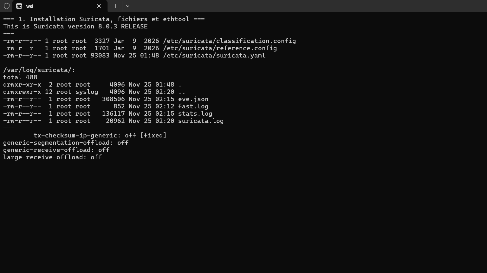
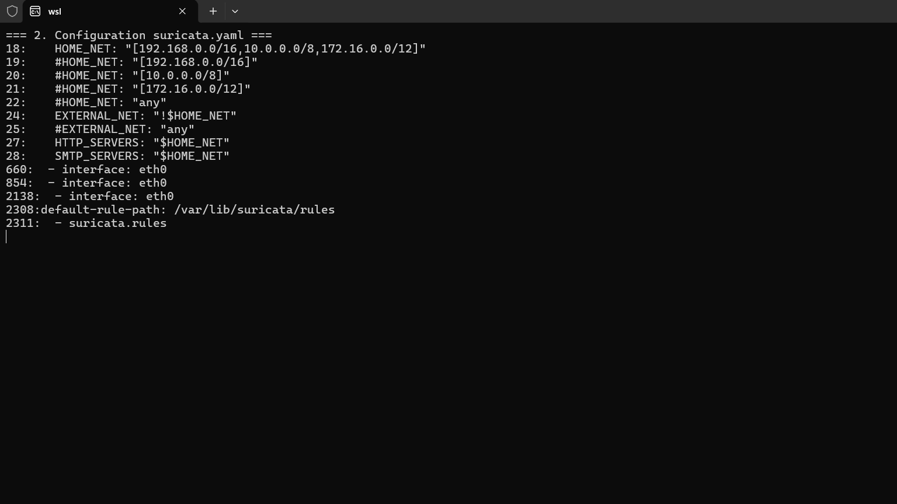
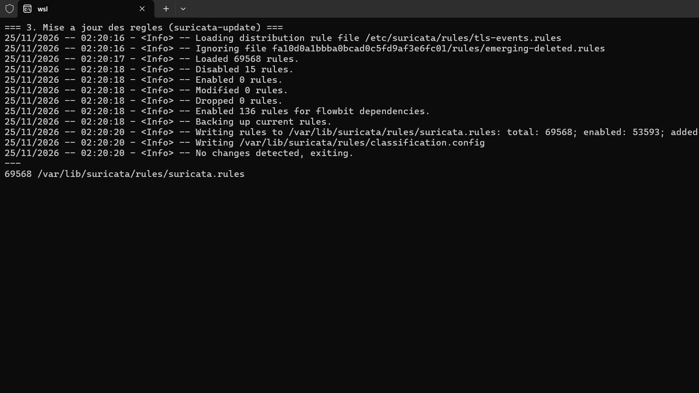
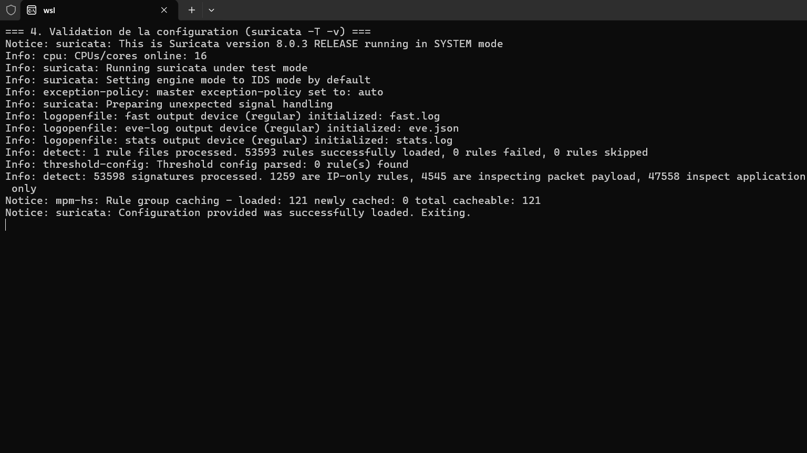
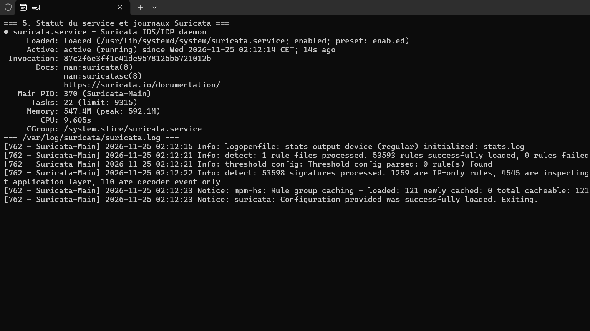
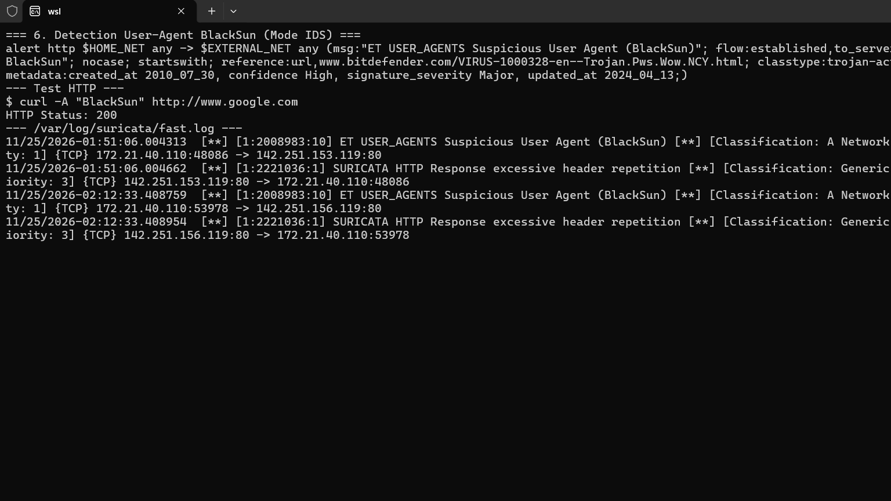

# TP 3 — Network Intrusion Prevention Systems Exploitation : Suricata (Partie 1)

**Module :** Intrusion Detection  
**Classe :** ING-5-J-SSIR  
**Année universitaire :** 2026–2027  
**Environnement :** WSL2 Ubuntu 26.04.1 LTS — Suricata 8.0.3 RELEASE  

---

## Table des matières

1. [Introduction et objectifs](#1-introduction-et-objectifs)
2. [Installation et vérification de l'environnement](#2-installation-et-vérification-de-lenvironnement)
3. [Configuration de `suricata.yaml` et optimisation réseau](#3-configuration-de-suricatayaml-et-optimisation-réseau)
4. [Mise à jour des règles via `suricata-update`](#4-mise-à-jour-des-règles-via-suricata-update)
5. [Validation et démarrage du service Suricata](#5-validation-et-démarrage-du-service-suricata)
6. [Exécution en mode IDS et détection `BlackSun` (`sid:2008983`)](#6-exécution-en-mode-ids-et-détection-blacksun-sid2008983)
7. [Réponses aux questions théoriques — Rôle des modificateurs](#7-réponses-aux-questions-théoriques--rôle-des-modificateurs)
8. [Conclusion](#8-conclusion)

---

## 1. Introduction et objectifs

**Suricata** est un moteur open source de détection et de prévention d'intrusion réseau capable d'opérer en mode **IDS** (*Intrusion Detection System*), **IPS** (*Intrusion Prevention System* inline), **NSM** (*Network Security Monitoring*) et d'analyser des captures PCAP hors ligne.

L'objectif de ce TP (Partie 1) est d'installer et de configurer Suricata sous Linux (adapté ici à **WSL2 Ubuntu 26.04** au lieu de CentOS 8), de charger le jeu de règles *Emerging Threats Open*, de valider la configuration, puis de tester la détection en mode IDS passif à l'aide d'un trafic HTTP simulant un User-Agent malveillant (`BlackSun`).

---

## 2. Installation et vérification de l'environnement

Sous Ubuntu 26.04 LTS (`resolute`), Suricata est disponible directement dans les dépôts APT (`1:8.0.3-1`). Après installation, nous vérifions la présence des fichiers et répertoires essentiels :

- `/etc/suricata/reference.config` : définit les types de références externes (URL, CVE, etc.).
- `/etc/suricata/classification.config` : définit les catégories d'alertes (`classtype`) et leur priorité associée.
- `/var/log/suricata/` : répertoire contenant les journaux (`suricata.log`, `fast.log`, `eve.json`, `stats.log`).
- `/etc/suricata/suricata.yaml` : fichier principal de configuration de Suricata.

```bash
sudo apt install -y suricata
suricata -V
ls -la /etc/suricata/reference.config /etc/suricata/classification.config /etc/suricata/suricata.yaml /var/log/suricata/
```

Pour éviter que la carte réseau ne regroupe les paquets avant l'inspection par Suricata (*packet offloading*), nous désactivons **GRO** (*Generic Receive Offload*) et **LRO** (*Large Receive Offload*) sur l'interface active `eth0` :

```bash
sudo ethtool -K eth0 gro off lro off
ethtool -k eth0 | grep -iE "generic|large"
```



---

## 3. Configuration de `suricata.yaml` et optimisation réseau

Dans `/etc/suricata/suricata.yaml` :
1. **Variables réseau :**
   - `HOME_NET: "[192.168.0.0/16,10.0.0.0/8,172.16.0.0/12]"` (incluant le sous-réseau `172.21.40.110/20` de `eth0` sous WSL2).
   - `EXTERNAL_NET: "!$HOME_NET"`.
   - `HTTP_SERVERS`, `SMTP_SERVERS`, `SQL_SERVERS`, `DNS_SERVERS`, `TELNET_SERVERS` pointant vers `$HOME_NET`.
2. **Capture `af-packet` :** interface définie sur `eth0`.
3. **Chemin des règles :**
   - `default-rule-path: /var/lib/suricata/rules`
   - `rule-files: - suricata.rules`



---

## 4. Mise à jour des règles via `suricata-update`

La commande `suricata-update` télécharge automatiquement la version du jeu de règles **Emerging Threats Open** adaptée à Suricata `8.0.3`, active les dépendances (`flowbits`) et génère `/var/lib/suricata/rules/suricata.rules`.

```bash
sudo suricata-update
wc -l /var/lib/suricata/rules/suricata.rules
```

- **Résultat obtenu :** `69 568` lignes dans `suricata.rules` (`53 593` règles actives chargées).



---

## 5. Validation et démarrage du service Suricata

Avant de démarrer le démon, nous validons la syntaxe de `suricata.yaml` et de toutes les règles avec l'option `-T -v` :

```bash
sudo suricata -c /etc/suricata/suricata.yaml -T -v
```

- **Résultat obtenu :** `53593 rules successfully loaded, 0 rules failed` et `Configuration provided was successfully loaded. Exiting.`



Nous activons ensuite le service `suricata` et vérifions son démarrage dans `/var/log/suricata/suricata.log` :

```bash
sudo systemctl enable --now suricata
sudo systemctl status suricata
tail /var/log/suricata/suricata.log
```



---

## 6. Exécution en mode IDS et détection `BlackSun` (`sid:2008983`)

La règle `sid:2008983` présente dans `/var/lib/suricata/rules/suricata.rules` déclenche une alerte dès qu'une requête HTTP sortante (`$HOME_NET -> $EXTERNAL_NET`) contient la chaîne `BlackSun` dans l'en-tête `User-Agent` (souvent utilisé par certains chevaux de Troie comme jeton d'authentification C2) :

```text
alert http $HOME_NET any -> $EXTERNAL_NET any (msg:"ET USER_AGENTS Suspicious User Agent (BlackSun)"; flow:established,to_server; http.user_agent; content:"BlackSun"; nocase; startswith; reference:url,www.bitdefender.com/VIRUS-1000328-en--Trojan.Pws.Wow.NCY.html; classtype:trojan-activity; sid:2008983; rev:10;)
```

Nous générons le trafic de test avec `curl` et consultons `/var/log/suricata/fast.log` :

```bash
curl -A "BlackSun" http://www.google.com
tail -f /var/log/suricata/fast.log
```

- **Résultat réellement obtenu :**
```text
11/25/2026-01:51:06.004313  [**] [1:2008983:10] ET USER_AGENTS Suspicious User Agent (BlackSun) [**] [Classification: A Network Trojan was detected] [Priority: 1] {TCP} 172.21.40.110:48086 -> 142.251.153.119:80
```



---

## 7. Réponses aux questions théoriques — Rôle des modificateurs

| Mot-clé / Modificateur | Rôle dans la règle Suricata |
|------------------------|-----------------------------|
| **`flow:to_server,established`** | Ne vérifie la règle que sur une session TCP déjà établie, dans le sens client vers serveur. |
| **`http.user_agent`** | Cible uniquement la valeur du champ d'en-tête HTTP `User-Agent` (buffer applicatif). |
| **`content:"BlackSun"`** | Recherche la chaîne exacte `"BlackSun"` dans la charge utile inspectée. |
| **`nocase`** | Rend la recherche insensible à la casse (`blacksun`, `BLACKSUN`, `BlackSun`). |
| **`depth:8`** | Limite la recherche aux 8 premiers octets du buffer inspecté (à partir de l'octet 0). |
| **`reference`** | Fournit un lien externe (URL, CVE, etc.) documentant la menace détectée. |
| **`classtype`** | Associe la règle à une catégorie définie dans `classification.config` (ex. `trojan-activity`, priorité 1). |
| **`sid`** | *Signature ID* : identifiant numérique unique de la règle (`2008983`). |
| **`rev`** | Numéro de révision de la signature, incrémenté à chaque modification de la règle. |

---

## 8. Conclusion

Ce TP a permis de déployer **Suricata 8.0.3** en mode **IDS passif** sous WSL2 Ubuntu 26.04, de configurer `suricata.yaml` pour l'interface `eth0`, de charger plus de **53 500 règles Emerging Threats Open** via `suricata-update`, et de valider la détection en temps réel d'un indicateur de compromission HTTP (`User-Agent: BlackSun`, `sid:2008983`) dans `/var/log/suricata/fast.log`.

